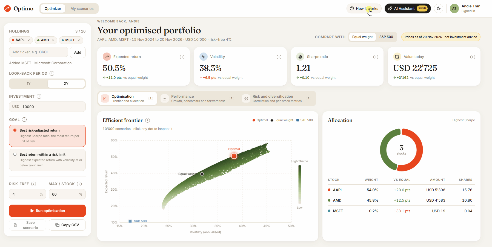

# Optimo: Portfolio Optimizer on Microsoft Fabric



## Architecture

```
Yahoo Finance (daily adjusted close)
     │  Python download script, rerun when the ticker list changes
     ▼
seed/tickers.csv  +  seed/prices.csv
     │  Rayfin seed step (one-time load)
     ▼
Fabric SQL database (created by Rayfin)
  Ticker · PriceBar · Scenario
     │  GraphQL API generated by Rayfin
     ▼
Optimo front end (React + TypeScript, Fabric/Entra sign-in)
  ├─ engine/  optimization maths, runs in the browser in a Web Worker
  └─ ui/      frontier, allocation, growth, forward test, risk views
```

The optimization runs in the browser. 10 stocks × 10,000 scenarios is about one million multiply-adds and finishes in well under a second. The back end therefore only reads prices and saves scenarios.

## Business Overview

Investors and analysts who split money across a handful of stocks often rely on gut feeling or simply weight every stock equally. Optimo is a Microsoft Fabric App that replaces that guesswork with a repeatable method. The user picks 2 to 10 stocks, and the app tests 10,000 random weightings to find the best one for the chosen goal. It then compares that portfolio with an equal-weight portfolio and the S&P 500.

Past data can flatter any weighting, so Optimo also runs a **forward test**. It picks weights on earlier data, holds them through the most recent 3, 6 or 12 months, and gives a plain verdict on whether the choice held up. Each user can save scenarios, reopen them and get the same result again.

## Aim

Build a Fabric App with Rayfin that turns a Python Monte Carlo portfolio notebook into an interactive, multi-user tool. Prices are stored in a Fabric SQL database, the optimization engine runs in TypeScript and is checked against the original Python results, and each user's saved scenarios stay private to them.

## Business Questions

For any set of 2 to 10 stocks a user selects from the prepared list:

1. Which weighting gives the **highest risk-adjusted return** (Sharpe ratio)?
2. Which weighting gives the **highest expected return while staying under a chosen volatility limit**?
3. Does the optimized portfolio beat an **equal-weight portfolio** and the **S&P 500** on return, volatility and Sharpe ratio?
4. Do weights chosen on past data **hold up on unseen data** in the most recent 3, 6 or 12 months?
5. How strongly do the selected stocks **move together** (correlation), and how much does diversifying actually help?

## Dataset Description

**Source:** [Yahoo Finance](https://finance.yahoo.com/) daily adjusted close prices, downloaded once into seed files. The app does not call Yahoo Finance live.

| | |
|---|---|
| Period | 2024-01-02 to 2026-11-20 (726 trading days) |
| Tickers | AAPL, AMD, MSFT, ORCL, plus SPY as the S&P 500 benchmark |
| Size | 3,630 price rows |
| Grain | One row = one ticker on one trading day |

The ticker list is the starting set for the first version. More stocks will be added to the list later. The app already supports up to 10 per run.

**Files in this repo:**

- [`seed/tickers.csv`](seed/tickers.csv) is the master ticker list.
  - `symbol`, `name`, `currency`
  - `is_benchmark`: exactly one row (SPY) is the benchmark
- [`seed/prices.csv`](seed/prices.csv) holds prices in long format.
  - `symbol`, `date` (ISO `YYYY-MM-DD`), `adj_close`

All prices are in USD. Price data © Yahoo Finance, used here for non-commercial demonstration only.

## Approach

1. **Download prices.** A Python script pulls adjusted close prices for every ticker in the master list. It refuses to write if the list has duplicates, no single benchmark, fewer than 2 stocks or an unknown symbol.
2. **Load into Fabric.** Rayfin seeds the prices into a Fabric SQL database and generates a GraphQL API over three models: `Ticker`, `PriceBar` and `Scenario`.
3. **Prepare returns.** The app keeps only the dates where every selected stock and SPY have a price, then calculates daily returns, the annualized mean and the sample covariance (252 trading days).
4. **Run the Monte Carlo search.** The app draws 10,000 random weightings with a fixed seed so results are reproducible, and rejects any draw where one stock exceeds the per-stock cap.
5. **Pick the winner.** For the chosen goal, the app takes either the highest Sharpe ratio or the highest return under the volatility limit. If no portfolio meets the limit, it falls back to the lowest-volatility one.
6. **Compare and measure.** The winner, the equal-weight portfolio and SPY are compared on return, volatility and Sharpe ratio. The comparison also covers buy-and-hold growth, max drawdown, best and worst days, and correlations.
7. **Forward test.** The app chooses weights on the training period only, holds them through the test period, and returns a verdict: *Held up*, *Mostly held up* or *Did not hold up*.
8. **Validate the engine.** The TypeScript engine is unit-tested against reference values from the original Python (pandas/NumPy) notebook on the same seed data, using tolerances of 1e-6 to 1e-3.
9. **Save scenarios.** Each user's settings and headline results are stored in their own scenario list. Reopening a scenario reruns the engine and reproduces the same numbers.

## Tech Stack

- **Platform:** Microsoft Fabric (Fabric Apps, Fabric SQL database), Rayfin
- **Front end:** React, Vite, TypeScript, ECharts, Tailwind CSS
- **Data and validation:** Python (yfinance, pandas, NumPy), Vitest
- **Auth:** Microsoft Entra ID (Fabric sign-in)

## Key Learning Takeaways

- Porting a Python notebook model to TypeScript is only trustworthy with a test harness. Comparing against Python reference values on the same data caught any drift in the formulas.
- A seeded random generator makes a Monte Carlo result reproducible, which is what lets a saved scenario reopen with the same answer.
- Running heavy maths in a Web Worker keeps the interface responsive without needing a back-end compute service.
- An optimizer that looks great on past data can still fail. A forward test on unseen data makes this visible to the user.

## Outlook

Optimo is a demo of the method, so a few things are deliberately simpler than in professional portfolio management. These are the ideas for later versions. None of them is scheduled yet.

**Closer to professional practice**

- **Minimum-volatility goal.** A goal that ignores return estimates, which practitioners trust least, and simply finds the calmest mix.
- **Risk measured against the S&P 500.** A tracking-error limit as an alternative to the volatility limit. Equity fund managers usually set their risk budget relative to a benchmark.
- **An exact optimizer.** A mathematical solver next to the random search, so the result is the true optimum rather than the best of 10,000 samples. This matters most above about six stocks.
- **More stable inputs.** Blending past returns with forecasts and smoothing the volatility and correlation estimates, so the optimizer chases last period's winners less.
- **Real-world constraints.** Sector limits, minimum weights, trading costs and limits on how much the portfolio changes at each rebalance.

**Product**

- A daily Fabric pipeline that keeps prices up to date.
- A base currency (CHF, EUR or USD) for non-USD stocks.
- Rebalancing trades from a user's current holdings.
- ESG scores with a minimum-ESG filter.
- Stress tests on past crises (2020, 2022).
- PDF or PowerPoint report export, and scenarios shared within a workspace.
- The AI Assistant connected to a Claude model, and Power BI reports on saved scenarios.

---

*Optimo describes past performance and is not investment advice.*
